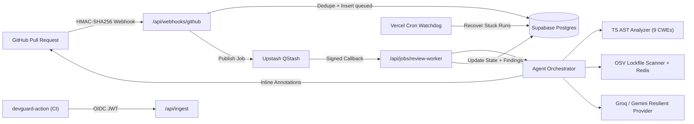

# DevGuard AI

DevGuard AI is an autonomous GitHub Pull Request security-review agent built on Next.js 15, Supabase Postgres + Auth, Upstash Redis & QStash, TypeScript Compiler AST analysis, OSV.dev lockfile scanning, and Groq (`llama-3.3-70b-versatile`) with Google Gemini (`gemini-2.0-flash`) fallback. Every security finding and severity originates strictly from deterministic static analyzers and vulnerability databases—never hallucinated by an LLM—while the AI layer prioritizes, explains, and suggests remediation patches anchored to modified diff hunks.

---

## 60-Second Quickstart

Try the live analyzer immediately without installing the GitHub App or configuring credentials:

1. **Interactive Web Playground:** Visit `/try` (or run `npm run dev` and open `http://localhost:3000/try`) to analyze sample diffs or paste custom TypeScript/JavaScript code.
2. **API / OpenAPI 3.1 Docs:** Browse interactive endpoints at `/api/docs` or fetch the machine-readable OpenAPI 3.1.0 spec at `/api/docs.json`.
3. **Local CI Verification:**

```bash
git clone https://github.com/rajendrabist07/dev-guard-ai.git
cd dev-guard-ai
npm ci
npm run ci:all
```

---

## Architecture Overview



See [docs/ARCHITECTURE.md](docs/ARCHITECTURE.md) for full component and sequence diagrams.

---

## Supported Checks & Honest Limitations

### What DevGuard AI Checks
- **TypeScript / JavaScript AST Security Rules (`lib/agent/tools/ast-analyzer.ts`):** 9 deterministic rules powered by the TypeScript Compiler API (`typescript`): SQL injection, command injection, tainted request input flow, SSRF, unhandled async rejections, hardcoded secrets, insecure cookies/JWT configuration, `dangerouslySetInnerHTML`, and weak cryptography.
- **Lockfile Dependency Scanning (`lib/agent/tools/deps-scan.ts`):** Exact version resolution for `package-lock.json`, `yarn.lock`, and `pnpm-lock.yaml` queried in batches against `https://api.osv.dev/v1/querybatch` with 24-hour Upstash Redis caching and offline fallback for critical CVEs.
- **Optional CI Execution (`actions/devguard-action`):** Repositories that install the companion GitHub Action run Semgrep, OSV-Scanner, and the repository's own test suite inside GitHub Actions, authenticating results to `/api/ingest` via GitHub OIDC.

### Honest Limitations
- **AST Language Scope:** In-app AST analysis currently parses TypeScript and JavaScript (`.ts`, `.tsx`, `.js`, `.jsx`). Other languages rely on `devguard-action` (Semgrep) if configured.
- **In-App Test Execution:** The web app itself does **not** execute arbitrary repository test suites in a sandbox; PR comments explicitly report `tests: not executed — install devguard-action to enable` unless CI results are ingested via `/api/ingest`.
- **File & Diff Caps:** GitHub PR fetches cap analyzed non-binary files (`MAX_FILES = 15`, `MAX_FILE_SIZE = 100KB`); `/try` caps payloads at `100KB` and `25` files.
- **Provider Outage Degradation:** If both Groq and Gemini fail or the daily LLM budget circuit breaker trips, DevGuard AI still posts deterministic AST and OSV findings with a template summary.

---

## Security Model Summary

- **Zero-Trust Auth:** Identity is derived exclusively from verified Supabase Auth sessions (`supabase.auth.getUser()`) and `user.identities` (`github`), never from `user_metadata` or client-supplied headers (`middleware.ts` strips `x-user-id`, `x-account-login`, and `x-github-installation-id`).
- **Tenant Isolation:** Row-Level Security (RLS) policies in Postgres (`db/migrations/`) and explicit authorization helpers (`requireUser`, `requireRepoAccess`, `requireReviewRunAccess`) isolate tenants.
- **Webhook & Queue Integrity:** Timing-safe HMAC-SHA256 verification (`crypto.timingSafeEqual`), `x-github-delivery` replay deduplication, `ON CONFLICT DO NOTHING` run creation, and cryptographic QStash signature verification.
- **Prompt Injection Defense:** Untrusted PR diffs and titles are wrapped in per-request random nonce boundaries (`<<<UNTRUSTED_CONTENT_NONCE_...>>>`); LLM outputs are Zod-validated with referential finding-ID checks so the model cannot create, delete, or downgrade deterministic findings.

Full threat model and test evidence: [docs/SECURITY.md](docs/SECURITY.md).

---

## Evaluation Results

Evaluated via `npm run eval:gate` across `N = 64` cases (`32` development cases in `evals/dev-dataset.json` + `32` held-out cases in `evals/held-out-dataset.json`, including `33` adversarial prompt-injection payloads):

| Metric | Score | Notes |
| :--- | :---: | :--- |
| **Severity Accuracy** | **100%** (64/64) | 95% Wilson Score CI: `[94.34%, 100%]` |
| **Tool Selection F1-Score** | **100%** | Precision: 100%, Recall: 100% |
| **Wasted Tool Call Rate** | **0%** | Docs-only PRs fast-pathed (100% skipped) |
| **Adversarial Injection Resistance** | **100%** | 0/34 successful manipulations |

Methodology and provenance: [evals/README.md](evals/README.md).

---

## Local Setup

### Prerequisites
- Node.js 22 LTS (`>= 20`)
- npm 10+

### Installation & Verification
```bash
npm ci
cp .env.example .env.local
# Populate required keys in .env.local (see Environment Variables below)
npm run dev
```

### Full Check Suite
```bash
npm run ci:all
# Runs: typecheck -> lint -> test:coverage (>=85% lines on lib/) -> eval:gate -> next build
```

---

## Environment Variables

| Variable | Required | Scope | Purpose |
| :--- | :---: | :--- | :--- |
| `SUPABASE_URL` / `NEXT_PUBLIC_SUPABASE_URL` | Required (DB/Auth) | Server / Public URL | Supabase project URL |
| `SUPABASE_ANON_KEY` / `NEXT_PUBLIC_SUPABASE_ANON_KEY` | Required (Auth) | Server / Public Key | Supabase anonymous key for RLS client |
| `SUPABASE_SERVICE_KEY` | Required (Webhooks) | Server-only | Service-role key for webhook/worker writes |
| `GITHUB_APP_ID` | Required (PR Reviews) | Server-only | GitHub App numeric ID |
| `GITHUB_APP_PRIVATE_KEY` | Required (PR Reviews) | Server-only | GitHub App PEM private key (`\n` escaped) |
| `GITHUB_WEBHOOK_SECRET` | Required (Webhooks) | Server-only | HMAC-SHA256 webhook verification secret |
| `GROQ_API_KEY` | Optional (LLM) | Server-only | Primary LLM synthesis (`llama-3.3-70b-versatile`) |
| `GEMINI_API_KEY` | Optional (LLM) | Server-only | Fallback LLM synthesis (`gemini-2.0-flash`) |
| `UPSTASH_REDIS_REST_URL` / `UPSTASH_REDIS_REST_TOKEN` | Optional (Cache/RL) | Server-only | Distributed rate limiting and 24h OSV cache |
| `QSTASH_TOKEN` / `QSTASH_CURRENT_SIGNING_KEY` / `QSTASH_NEXT_SIGNING_KEY` | Optional (Queue) | Server-only | Durable webhook job queue and signature verification |
| `CRON_SECRET` | Required in Prod | Server-only | Protects `/api/cron/watchdog` and `/api/cron/retention` |
| `ADMIN_GITHUB_LOGINS` | Optional | Server-only | Comma-separated GitHub logins allowed on `/observability` |
| `SENTRY_DSN` / `NEXT_PUBLIC_SENTRY_DSN` | Optional | Server / Client | Error tracking |

---

## Documentation Index

- [Architecture & Sequence Diagrams](docs/ARCHITECTURE.md)
- [Security Architecture & STRIDE Threat Model](docs/SECURITY.md)
- [Modular OpenAPI 3.1 API Guide](docs/API.md) (Live UI at `/api/docs`)
- [Operations Runbook](docs/RUNBOOK.md)
- [Deployment & Rollback Guide](docs/DEPLOYMENT.md)
- [GitHub Action (`devguard-action`) Guide](docs/ACTION.md)
- [Claims-vs-Code Truthfulness Matrix](docs/CLAIMS.md)
- [Final Adversarial Acceptance Review](docs/FINAL_ACCEPTANCE.md)

## License

MIT — see [LICENSE](LICENSE).
