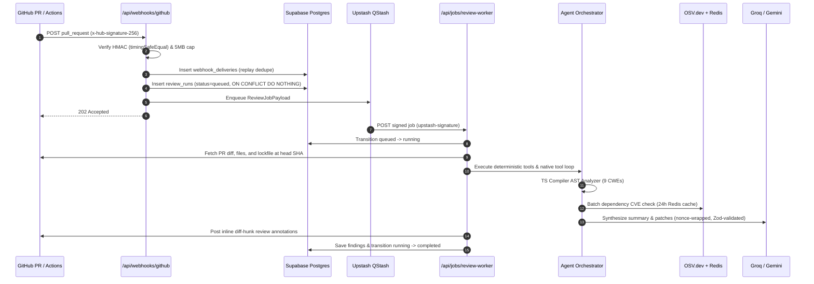
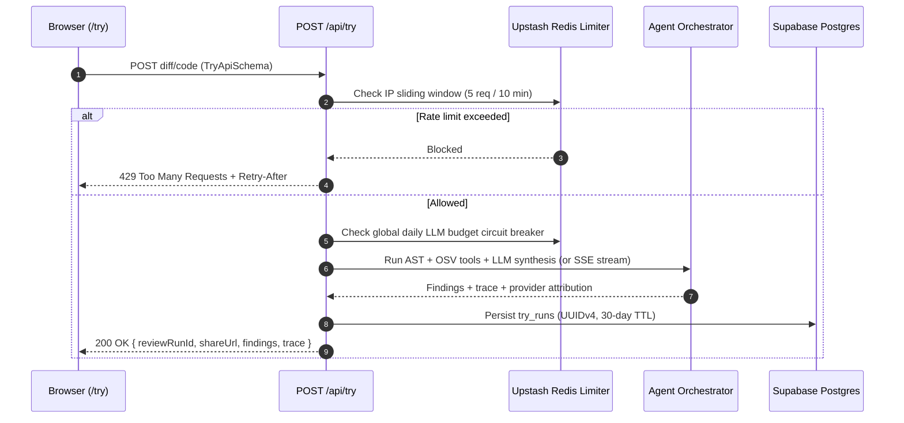

# DevGuard AI — System Architecture

## 1. Core Components

1. **Web UI & Edge Middleware (`app/`, `components/`, `middleware.ts`):**
   - Next.js 15 App Router serving the landing page (`/`), interactive playground (`/try`, `/try/result/[id]`), authenticated dashboard (`/dashboard`, `/dashboard/runs/[id]`), and operator telemetry (`/observability`).
   - Edge middleware strips spoofable identity headers and enforces session / admin allowlist gates.
2. **Webhook & Durable Queue Pipeline (`app/api/webhooks/github`, `lib/queue/qstash.ts`, `app/api/jobs/review-worker`):**
   - Verifies GitHub HMAC-SHA256 signatures, deduplicates `x-github-delivery`, atomically inserts a `queued` run, and dispatches to Upstash QStash.
   - Worker endpoint verifies `upstash-signature`, transitions state (`queued -> running -> completed | failed | timed_out`), executes the review pipeline, and posts inline/summary comments via Octokit.
3. **Deterministic Analysis & AI Orchestration (`lib/agent/`):**
   - **AST Analyzer (`lib/agent/tools/ast-analyzer.ts`):** TypeScript Compiler API visitor checking 9 CWE classes.
   - **Lockfile Scanner (`lib/agent/tools/deps-scan.ts`, `lockfile-parser.ts`):** Resolves exact versions from `package-lock.json`, `yarn.lock`, and `pnpm-lock.yaml`, querying `api.osv.dev` with 24h Upstash Redis caching.
   - **Resilient LLM Provider (`lib/agent/providers/`):** `GroqProvider` (`llama-3.3-70b-versatile`) with circuit breaker and `GeminiProvider` (`gemini-2.0-flash`) fallback, strict Zod output schema (`ReviewSynthesisSchema`), 1-repair retry, and referential finding-ID validation.
4. **Persistence & Observability (`lib/db/supabase.ts`, `lib/observability/`):**
   - Supabase Postgres (`db/migrations/`) with Row-Level Security, redacted structured logging (`system_logs`), and Vercel Cron watchdog/retention jobs (`vercel.json`).

---

## 2. Sequence Diagram — GitHub PR Webhook Flow

---

## 3. Sequence Diagram — Interactive Playground (`/try`) Flow

